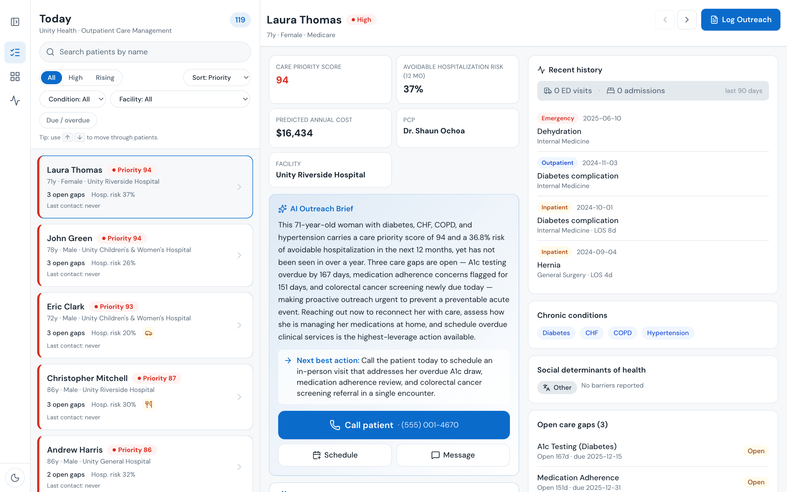
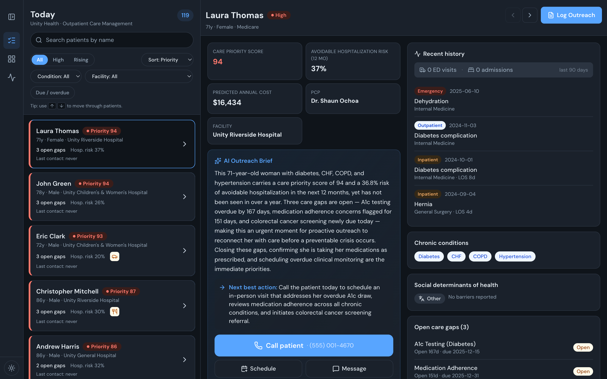
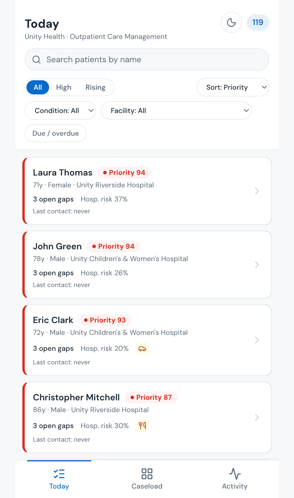
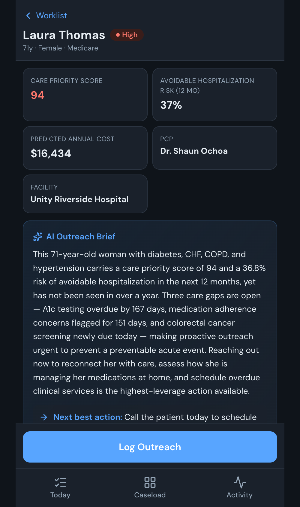

# Care Manager

**Know who to call today, why they matter, and reach them — from your desk or your phone.**

Care Manager is an outpatient care-management worklist for community-based nurse care
managers. It ranks a care manager's caseload by a **Care Priority Score**, explains *why
each patient needs outreach now* with an AI brief, drafts a warm patient message (in the
patient's language), and logs the call — all over one shared population-health dataset.



> A Databricks App (FastAPI + React) on **Lakebase Postgres** + **Foundation Model API
> (Claude)**. One install also stands up a matching **Population Health Genie space** and
> **AI/BI dashboard** over the same data — app, natural-language SQL, and BI on one dataset.

---

## What it does

| Capability | What the care manager gets |
|---|---|
| 🗂️ **Prioritized worklist** | Their ~120 highest-need patients (High/Rising risk, open care gaps) ranked by a Care Priority Score — not the whole population. |
| 🧠 **AI outreach brief** | A 2–3 sentence brief on *why reach out now* + a next-best-action, grounded only in the patient's real risk, gaps, and SDOH — no invented clinical facts. |
| 💬 **Patient message drafting** | A warm, plain-language outreach message addressed to the patient, drafted and translatable into their preferred language (English, Spanish, Vietnamese, Chinese, …). |
| 🤖 **Ask-AI copilot** | Conversational Q&A about *this* patient ("what's driving their risk?", "draft a call script"), grounded in their record and recent notes. |
| 📝 **Dictate → structured log** | Speak or type a free-text recap after a call; AI parses it into a structured outreach entry (action, gaps addressed, follow-up) for one-tap logging. |
| 📊 **Panel & activity** | Population KPIs and a per-care-manager activity feed of who was contacted and which gaps were closed. |
| 📱 **Field-ready** | Fully responsive — the same worklist and tools on a phone, for outreach on the move. |

The same synthetic dataset also powers a **Population Health Genie space** (ask questions
in plain English — "which high-risk diabetics have an open A1c gap and no visit in 6
months?") and a **Population Health AI/BI dashboard**, so one install demonstrates an
operational app, natural-language analytics, and executive BI over a single source of truth.

## See it in action

**Desktop** — a two-pane worklist → patient detail, with the AI outreach brief front and center (light and dark):

| Prioritized worklist + AI brief (light) | Same, dark theme |
|-------|------|
|  |  |

**Mobile** — the full experience on a phone, for outreach in the field:

| Caseload on your phone | Patient detail + outreach tools |
|----------|----------------|
|  |  |

## About

Care Manager is a **Databricks field demo — not a supported product.** It uses
**fully synthetic data**; there are no real patients and no PHI. Provided as-is,
best-effort, for demonstration and evaluation only.

- **Maintainer:** Databricks Field Engineering — HLS. File issues/questions via the repo's GitHub Issues.
- **What it demonstrates:** Databricks Apps + Lakebase (Postgres) + Foundation
  Model API (Claude) + a Genie space + an AI/BI dashboard, all over one shared
  population-health dataset in a healthcare provider workflow, deployable into
  any workspace via a Databricks Asset Bundle.

---

## Install in your workspace (Databricks Asset Bundle)

The app ships as a DAB (`databricks.yml`). Installing has an inherent two-phase
dependency — the Lakebase instance/DB must exist *before* the app binds to it,
and the app's service principal can only be granted DB access *after* the app is
created — so `install.sh` sequences it into one idempotent command.

### Requirements
- **Databricks CLI ≥ 0.296.0.** Older versions may ship a stale Terraform
  provider key (breaks `bundle deploy`) and lack `--force-refresh`. The Lakebase
  bundle resource also needs a recent CLI.
- **Python 3.12** for the data-generation / seed scripts. Do **not** use 3.13+ —
  `databricks-connect`'s cloudpickle currently fails under 3.14 (the scripts pin
  3.12 via `uv run --python 3.12`).
- **[uv](https://docs.astral.sh/uv/)** to run the scripts (`install.sh` uses it).
- A Databricks workspace with the entitlements listed under Prerequisites below.

### Prerequisites (workspace entitlements the installer cannot create)
- Unity Catalog + a catalog you can write to (`--catalog`).
- **Lakebase** enabled for the workspace (the installer creates the *instance*,
  but the feature must be enabled).
- A SQL warehouse (`--warehouse`).
- **Foundation Model API / Claude** access (`--endpoint`, default
  `databricks-claude-sonnet-4-6`).

### One-command install
```
./install.sh \
  --profile   <cli_profile> \
  --catalog   <your_catalog> \
  --warehouse <your_warehouse_id> \
  --endpoint  <your_claude_endpoint> \
  --target    prod
```
This runs, idempotently:
1. **provision** — create the Lakebase instance (if absent) + logical database.
2. **bundle deploy** — create the app and seed job.
3. **seed** — generate the synthetic dataset and load Lakebase (`--seed local`
   runs it from your machine; `--seed job` runs it as the bundle's `seed` job).
4. **grant** — discover the app's service principal and grant it on the database.
5. **analytics** — deploy the Population Health Genie space + AI/BI dashboard
   over the catalog (optional; non-fatal if it fails).
6. **run** — (re)deploy the app so it connects with its grants.

The app URL is printed at the end. Re-run any time; each step is idempotent.

### Or step-by-step with the CLI
```
LAKEBASE_INSTANCE=care-manager-db uv run python scripts/provision.py
databricks bundle deploy -t prod --var catalog=… --var warehouse_id=… --var serving_endpoint=…
databricks bundle run seed -t prod          # generate data + load + grant SP
databricks bundle run care_manager -t prod  # (re)deploy the app
```

> **Service principal grant.** The app connects to Lakebase as its own service
> principal (auto-registered as a Postgres role by the `database` app resource).
> `scripts/grant_app_sp.py` discovers that SP dynamically and grants it — no
> hardcoded ids. It runs as the final `seed` job task and inside `install.sh`.

## Uninstall

```
./uninstall.sh --profile <cli_profile> --target prod    # app + seed job + drop the caremanager DB
./uninstall.sh --profile <cli_profile> --delete-instance # also delete the Lakebase instance
```
Idempotent. It does **not** drop the Unity Catalog `--catalog` (it may hold
other assets) — drop that yourself if you want the synthetic data gone.

## Local development
```
# backend (serves the prebuilt frontend/dist)
DATABRICKS_PROFILE=<profile> uv run python -m uvicorn app:app --port 8000
# frontend hot reload (optional)
cd frontend && npm run dev
```

## Under the hood — what gets installed

A single install (`install.sh`) provisions all of the following into your
workspace, over one shared synthetic dataset:

| Component | What it is |
|---|---|
| **Synthetic dataset** (Unity Catalog) | ~575K rows across 26 gold tables for a fictional 5-hospital system ("Unity Health") — patients, encounters, care gaps, risk scores, SDOH, and GenAI-authored clinical notes. Deterministic (seed=42), no PII/PHI. |
| **Lakebase (Postgres) instance + DB** | `care-manager-db` / `caremanager` — the operational read store the app queries at runtime, seeded from the catalog. |
| **Databricks App** | "Care Manager" — a FastAPI + React worklist (responsive, light/dark) with AI outreach briefs, patient messaging, and an outreach log. Bound to a SQL warehouse, the serving endpoint, and the Lakebase DB. |
| **Genie space** | "Population Health" — natural-language SQL over the same gold tables (risk stratification, care gaps, SDOH, clinical notes). |
| **AI/BI dashboard** | "Population Health" — a Lakeview dashboard on the same data. |
| **Seed job** | `care-manager-seed` — the bundle job that generates the data, loads Lakebase, grants the app service principal, and deploys the Genie space + dashboard. |

It also **uses** (does not create) a **serving endpoint** for AI briefs (Claude
via the Foundation Model API) and a **SQL warehouse** for the seed job, Genie,
and the dashboard — both are workspace resources you point it at.

## Production considerations

This is a **field demo over synthetic data**, not production clinical software.
The engineering foundation is sound — parameterized SQL, a connection pool that
rotates credentials before the OAuth token expires, per-connection OAuth token
minting, TLS to Lakebase, and graceful degradation when the model endpoint is
down — but productionizing it for real PHI is a real project. What the platform
handles vs. what the app-as-written still needs:

**The Databricks platform already covers (configure, don't rebuild):**
- **LLM governance** — the app calls the workspace Foundation Model API, so
  rate limiting, cost/usage tracking, payload logging, guardrails, and PII
  detection are available by attaching **AI Gateway** policies to the serving
  endpoint. These are governance settings to turn on, not app code.
- **Catalog-side data governance** — the Genie space and AI/BI dashboard query
  the Unity Catalog gold tables **as the signed-in user**, so UC row filters,
  column masks, and grants apply to them normally.
- **Credential handling** — short-lived, auto-rotated Lakebase OAuth tokens and
  an auto-provisioned app service principal.

**The app-as-written still needs (not automatic under the current design):**
- **Per-user authorization.** The app reads Lakebase as a **single service
  principal** — the end-user identity is only an HTTP header used for demo-style
  caseload *bucketing* (`hashtext(email) % N`), not real access control. Because
  every request hits the database as the same SP, **Unity Catalog cannot enforce
  "this care manager sees only their patients"** at the data layer. Notably,
  `GET /patients/{id}` fetches any patient by id with no per-user scope. Real
  authZ requires either (a) checking the user's permissions per request in the
  app, or (b) connecting to data with user-identity passthrough / on-behalf-of
  instead of a shared SP, so UC governance can evaluate against the actual user.
- **Audit logging.** No access/audit trail of who viewed which patient — often a
  legal requirement in healthcare. Add structured logging + an audit sink.
- **Clinical/AI review.** AI-generated briefs and messages reach a clinician
  surface directly. Beyond AI Gateway, a production clinical deployment needs
  output review/grounding policy, AI-generated labeling, and the appropriate
  regulatory/compliance review (HIPAA; AI-in-clinical-decision-support).
- **Tests, observability, migrations.** No automated tests, metrics/tracing, or
  versioned schema migrations (the schema is created imperatively at startup).
- **Data freshness & HA.** The app reads a Lakebase copy seeded in batch from
  the catalog (no live sync), on a single-node `CU_1` instance (no HA/DR). A
  production build needs an ingestion pipeline and a resilient instance tier.

Treat the architecture as a validated starting point; the authorization model
and the audit/compliance layer would be built, not patched.

## Configuration (env / app.yaml)
| Var | Purpose | Default |
|-----|---------|---------|
| `SERVING_ENDPOINT` | Claude serving endpoint for AI briefs | `databricks-claude-sonnet-4-6` |
| `AI_GATEWAY_URL` | Optional explicit FMAPI base URL. **Unset** → derived from the app's own workspace host (portable across workspaces/clouds). | unset |
| `CATALOG` | UC catalog (used only by the seed job) | `hls_provider` |
| `WAREHOUSE_ID` | SQL warehouse for the seed job | — |
| `LAKEBASE_INSTANCE` | Lakebase instance name | `care-manager-db` |
| `PGDATABASE` | Logical Postgres database | `caremanager` |

`PGHOST`/`PGUSER`/`PGPORT` are injected at runtime by the `database` app resource.
